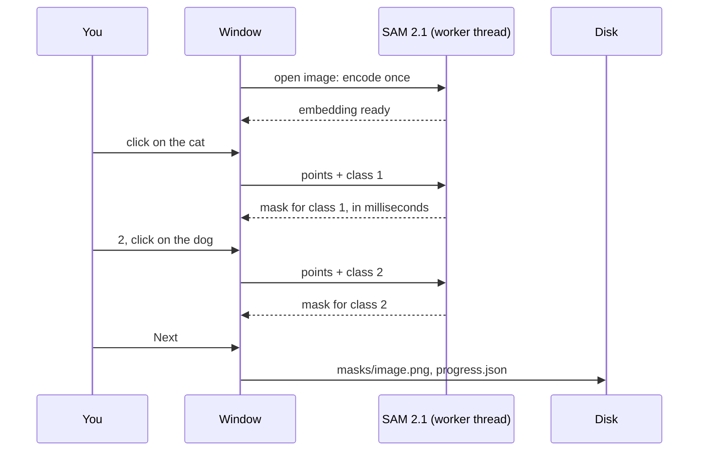

<div align="center">

# Assisted Semantic Segmentation Tool SAM2

**Click an object. SAM 2.1 traces it. Press Next.**

Semantic segmentation masks for your own classes, one training-ready PNG per image.

[](LICENSE)
[](https://www.python.org/)
[](https://github.com/facebookresearch/sam2)
[](https://pytorch.org/)
[](https://doc.qt.io/qtforpython-6/)

<br>


<sub>Two classes, two clicks: <code>cat</code> in green, <code>dog</code> in blue.</sub>

</div>

<br>

<table>
<tr>
<td width="33%" align="center" valign="top">

**1 &nbsp; Name your classes**

`cat, dog` or `crack, rust, dent`.<br>
Anything, in any number.

</td>
<td width="33%" align="center" valign="top">

**2 &nbsp; Click the object**

SAM 2.1 outlines it.<br>
More clicks refine, a brush fixes the rest.

</td>
<td width="33%" align="center" valign="top">

**3 &nbsp; Press Next**

The image is saved as a class-id mask.<br>
No save button to forget.

</td>
</tr>
</table>

## Install

```bash
git clone https://github.com/marwen-dhifi/Assisted-Semantic-Segmentation-Tool-SAM2.git
cd Assisted-Semantic-Segmentation-Tool-SAM2
python -m venv .venv && .venv\Scripts\activate     # Linux / macOS: source .venv/bin/activate

pip install torch --index-url https://download.pytorch.org/whl/cu128
pip install -e .
```

Install PyTorch first, from the index that matches your CUDA version on
[pytorch.org](https://pytorch.org/get-started/locally/): a plain `pip install torch` on Windows is the
CPU-only build. Then start it with `sam2-annotator`, or open `src/run.py` in an editor and press Run.

A dialog asks for three things: the image folder, the classes, and where the masks go. To try it,
choose `sample_data` with `cat, dog`.

## Controls

<table>
<tr>
<th align="left">Prompting</th>
<th align="left">Brush</th>
<th align="left">Navigation</th>
</tr>
<tr>
<td valign="top">

<kbd>1</kbd> to <kbd>9</kbd> &nbsp; active class<br>
<kbd>Left click</kbd> &nbsp; object point<br>
<kbd>Shift</kbd> + <kbd>Left click</kbd> &nbsp; exclude<br>
<kbd>Right click</kbd> &nbsp; undo point<br>
<kbd>C</kbd> &nbsp; clear the class

</td>
<td valign="top">

<kbd>B</kbd> &nbsp; point / brush mode<br>
<kbd>Left drag</kbd> &nbsp; paint<br>
<kbd>Right drag</kbd> &nbsp; erase<br>
<kbd>Wheel</kbd> or <kbd>[</kbd> <kbd>]</kbd> &nbsp; radius

</td>
<td valign="top">

<kbd>D</kbd> &nbsp; next, saves<br>
<kbd>Q</kbd> &nbsp; previous, saves<br>
<kbd>Delete</kbd> &nbsp; delete image<br>
<kbd>H</kbd> &nbsp; shortcut card

</td>
</tr>
</table>

Every point of the active class feeds one prediction, so a second click on a missed leg grows the
same mask instead of starting a new one. Leaving an image in any way (<kbd>D</kbd>, <kbd>Q</kbd>, Jump
to #, closing the window) saves it; an image counts as annotated once it has a mask, and the window
reopens on the first one without.

## What gets written

```
sample_data_annotations/
├── masks/
│   └── images (1).png      one per annotated image, same size as the image
├── classes.json            {"classes": ["cat", "dog"]}
└── progress.json           which images are annotated
```

A mask is a single-channel 8-bit PNG in which every pixel holds the id of its class: `0` for
background, `1` for the first class in the list, `2` for the second, up to 255 classes. It is the
label format that YOLO semantic segmentation, torchvision and segmentation_models expect as is.

```python
import cv2, numpy as np

mask = cv2.imread("sample_data_annotations/masks/images (1).png", cv2.IMREAD_UNCHANGED)
np.unique(mask)            # array([0, 1, 2], dtype=uint8)
cats = mask == 1
```

## Under the hood



SAM 2.1 is a heavy image encoder followed by a light prompt decoder. The encoder runs once when an
image opens, on a worker thread so the window stays responsive; each click then runs only the decoder
against the cached embedding, which is why refining feels immediate. Every request carries the image
path and the class, so a late answer for an image you already left is discarded.

| | Model on first start | Why |
|---|---|---|
| **GPU** | `sam2.1-hiera-base-plus`, 324 MB | follows fur, thin edges and low contrast well |
| **CPU** | `sam2.1-hiera-small` | keeps encoding usable without CUDA |

`--model facebook/sam2.1-hiera-large` or `-tiny` trades speed for edge quality either way.

## Questions

<details>
<summary><b>Why does the first start take a while?</b></summary>
<br>
The model weights are downloaded from Hugging Face on first use and cached in
<code>~/.cache/huggingface</code>. Every later start loads them from disk and works offline.
</details>

<details>
<summary><b>My masks look completely black.</b></summary>
<br>
They are fine. The pixel values are class ids such as 1 and 2 out of 255, which an image viewer
shows as black. Read them with <code>cv2.IMREAD_UNCHANGED</code> as above.
</details>

<details>
<summary><b>Can I add or reorder classes later?</b></summary>
<br>
Not in the same output folder. The masks store ids, not names, so a new order would silently relabel
every saved mask; the setup dialog refuses it and names the classes the folder was made with. Use a
new output folder for a new class list.
</details>

<details>
<summary><b>What happens where two objects overlap?</b></summary>
<br>
The class later in the list wins on the shared pixels, so the result does not depend on the order
you clicked in.
</details>

<details>
<summary><b>Can I skip the dialog?</b></summary>
<br>

```bash
sam2-annotator sample_data --classes cat,dog --out annotations --device cuda --model facebook/sam2.1-hiera-large
```

Without `--classes` the dialog opens, prefilled with whatever was given. The output defaults to
`<images>_annotations` next to the image folder.
</details>

<details>
<summary><b>Does Delete really delete?</b></summary>
<br>
Yes: after a confirmation it removes the image file and its mask from disk, for pruning blurred or
irrelevant frames out of a dataset. Nothing else in the tool deletes files.
</details>

<br>

<div align="center">
<sub>MIT License, © 2026 Marwen Dhifi</sub>
</div>
