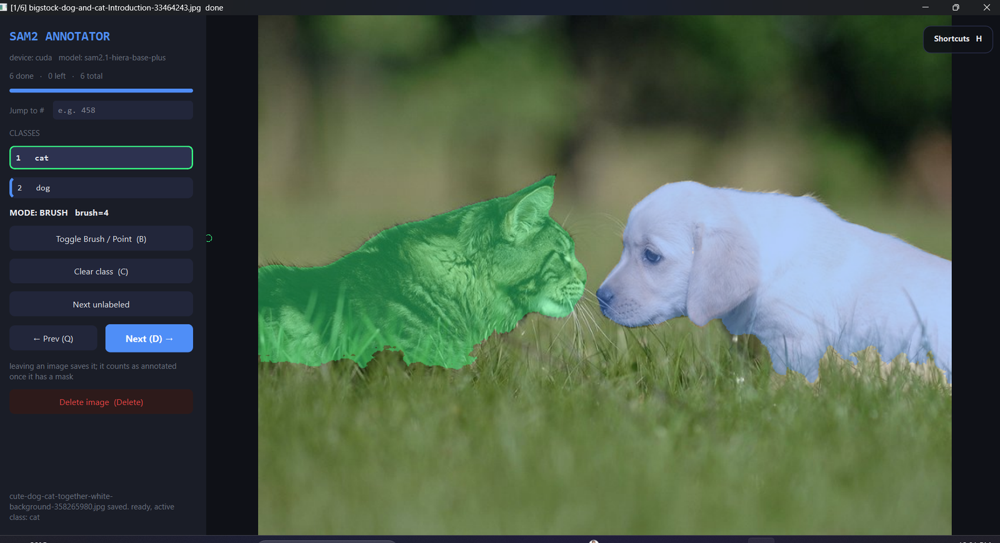
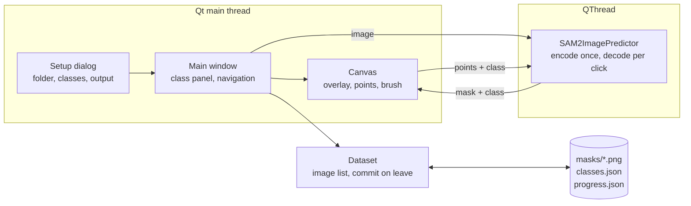

<div align="center">

# Assisted Semantic Segmentation Tool SAM2

**Semantic segmentation masks from a few clicks, with SAM 2.1 doing the outlining.**

Name your classes, click on an object, and SAM 2.1 traces it. Refine with more clicks or a brush,
move on, and every image is saved as a class-id mask ready for training.

[](LICENSE)
[](https://www.python.org/)
[](https://github.com/facebookresearch/sam2)
[](https://pytorch.org/)
[](https://doc.qt.io/qtforpython-6/)

</div>

---

## The problem

Pixel masks are the most expensive labels in computer vision. Drawing a polygon around one object
takes a minute; a dataset needs thousands of them, and most general annotation platforms are built
for teams, servers and bounding boxes rather than for one engineer with a folder of images.

SAM 2.1 can outline almost any object from a single point, but on its own it produces one anonymous
mask per click. This tool turns it into a labeling workflow: classes you define, several objects per
image, corrections where the model misses, and one training-ready mask per image written to disk as
you go.

---

## What it does

<table>
<tr>
<td width="50%" valign="top">

### Your classes
Any class list, entered at start: `cat, dog`, `crack, rust, dent`, `water, floor`. Keys `1` to `9`
switch the active class; each class has its own color on the overlay.

</td>
<td width="50%" valign="top">

### Click to segment
A left click on an object runs SAM 2.1 and outlines it. Further clicks refine the same mask,
Shift+click excludes a region, right click undoes the last point.

</td>
</tr>
<tr>
<td width="50%" valign="top">

### Brush where the model misses
`B` switches to a brush that paints or erases the active class, sized with the mouse wheel. Useful
for thin edges, fur and reflections.

</td>
<td width="50%" valign="top">

### Saved as you go
Moving to another image saves the current one. One PNG per image holds every class as its id,
ready for semantic segmentation training.

</td>
</tr>
</table>

---

## Quick start

> **Prerequisites**: Python **3.10+**. An NVIDIA GPU is recommended; the tool falls back to CPU with the
> smaller model.

**1. Install PyTorch with CUDA, then the tool**

```bash
git clone https://github.com/marwen-dhifi/Assisted-Semantic-Segmentation-Tool-SAM2.git
cd Assisted-Semantic-Segmentation-Tool-SAM2
python -m venv .venv
.venv\Scripts\activate             # Linux / macOS:  source .venv/bin/activate

pip install torch --index-url https://download.pytorch.org/whl/cu128
pip install -e .
```

A plain `pip install torch` on Windows installs the CPU-only build. Pick the index that matches your
CUDA version on [pytorch.org](https://pytorch.org/get-started/locally/).

**2. Run**

```bash
sam2-annotator                     # or open src/run.py in an editor and press Run
```

A setup dialog asks for the image folder, the classes and the output folder. On the first start the
model weights are downloaded from Hugging Face (about 324 MB for `sam2.1-hiera-base-plus`) and cached;
later starts work offline.

**3. Try it on the samples.** Choose `sample_data` with the classes `cat, dog`.

---

## Using it



The window opens on the first image that has no mask yet. Pick a class, click on the object, and SAM
2.1 outlines it; every point of the active class feeds one prediction, so a second click on a missed
part grows the same mask instead of starting a new one. Switch class and repeat for the next object.

Leaving an image saves it: **Next**, **Prev**, **Jump to #**, **Next unlabeled**, or closing the
window. An image counts as annotated once it has a mask; looking at an image without drawing writes
nothing, and clearing a saved image removes its mask file. The **Shortcuts** card in the top right
corner lists every key.

| Key | Action |
|---|---|
| `1` to `9` | active class |
| `Left click` | object point for the active class |
| `Shift + Left click` | exclude point |
| `Right click` | undo the last point |
| `B` | switch between point and brush mode |
| `Left / Right drag` | paint / erase in brush mode |
| `Wheel`, `[` `]` | brush radius, 2 to 200 px |
| `C` | clear the active class on this image |
| `D` / `Q` | next / previous image, saving the current one |
| `Delete` | delete the image file and its mask, after confirmation |
| `H` | show or hide the shortcut card |

The setup dialog remembers the last folder, classes and output in `~/.sam2_annotator.json`.

---

## How it works



SAM 2.1 splits into a heavy image encoder and a light prompt decoder. The encoder runs **once per
image** when it is opened, on a worker thread so the window never freezes; every click afterwards only
runs the decoder against the cached embedding, which is what makes refinement feel instant. Each
request carries the image path and the class index, so a result that arrives after the user moved on
is dropped instead of landing on the wrong image or class.

### Models

| Device | Default model | Notes |
|---|---|---|
| CUDA | `facebook/sam2.1-hiera-base-plus` | follows thin and low-contrast regions well |
| CPU | `facebook/sam2.1-hiera-small` | keeps encoding usable without a GPU |

Any SAM 2.1 checkpoint on Hugging Face works with `--model`, for example `facebook/sam2.1-hiera-large`
for the best edges or `facebook/sam2.1-hiera-tiny` for speed.

---

## Output

```
sample_data_annotations/
├── classes.json           {"classes": ["cat", "dog"]}
├── progress.json          {"done": ["images (1).jpg", ...]}
└── masks/
    ├── images (1).png
    └── ...
```

Each mask is a single-channel 8-bit PNG with the size of its image. A pixel holds the id of its class:

| Pixel value | Meaning |
|---|---|
| `0` | background |
| `1` | first class in the list, `cat` |
| `2` | second class, `dog` |
| `k` | class `k` in the list, up to 255 |

Where masks of two classes overlap, the class later in the list wins. Subfolders of the image folder
are mirrored under `masks/`. Because the masks store ids rather than names, reopening an output
folder with a different class list or order is refused.

In an ordinary image viewer the masks look black, since the ids are small values. To read one:

```python
import cv2, numpy as np

mask = cv2.imread("masks/images (1).png", cv2.IMREAD_UNCHANGED)
print(np.unique(mask))     # [0 1 2]
dog = mask == 2            # boolean mask of one class
```

This is the input format of YOLO semantic segmentation, torchvision and segmentation_models training.

---

## Command line

<details>
<summary><b>All options</b></summary>

<br>

Without `--classes` the setup dialog opens, prefilled with any options given.

```bash
sam2-annotator sample_data --classes cat,dog --out annotations --device cuda
```

| Option | Meaning |
|---|---|
| `images` | image folder, scanned recursively (`jpg png bmp tif`) |
| `--classes a,b,c` | class list, skips the setup dialog |
| `--out DIR` | output folder, default `<images>_annotations` |
| `--device cuda\|cpu` | default: CUDA when available |
| `--model ID` | Hugging Face model id, default depends on the device |

</details>

---

## Repository layout

```
sam2-annotator/
├── src/
│   ├── run.py              # editor entry point, falls back to the repo .venv
│   └── sam2_annotator/
│       ├── config.py       # model choice, class palette, brush limits
│       ├── dataset.py      # image list, class check, commit on leave, delete
│       ├── worker.py       # SAM 2.1 predictor on a QThread
│       ├── canvas.py       # overlay, per-class points and masks, brush
│       ├── window.py       # class panel, navigation, keys
│       ├── setup.py        # start dialog
│       ├── shortcuts.py    # collapsible shortcut card
│       ├── imageio.py      # image IO that handles non-ASCII Windows paths
│       ├── theme.py        # colors and style sheets
│       └── __main__.py     # command line
├── sample_data/            # cat and dog images
└── docs/images/
```

---

## License

[MIT](LICENSE) © 2026 Marwen Dhifi
